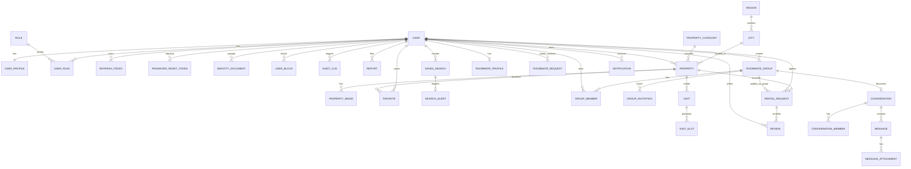

# Diagramme ERD (33 tables)

Règles clés : `rental_request` a exactement un demandeur (utilisateur **ou** groupe, contrainte CHECK) ;
`review` n'est créée que pour une demande `CONFIRMED` (vérifié par le use case) ; suppression logique des annonces (`deleted_at`).
Détail des colonnes : `data-dictionary.md`.
